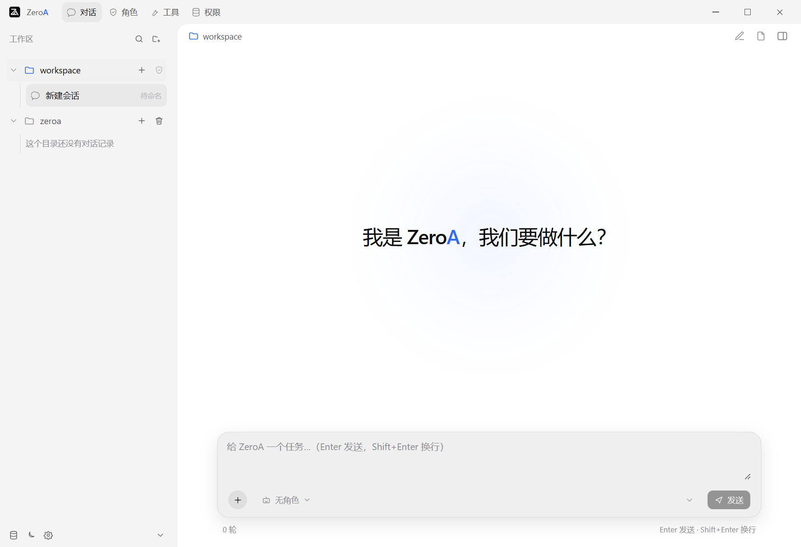

<p align="center">
  
</p>

<h1 align="center">ZeroA</h1>

<p align="center">
  本地多智能体工作台：自定义角色，编排子智能体，组装你的工作体<br>
  Wails v3 · Go · React/TypeScript · GPL-3.0 License
</p>

> ⚠️ **使用前必读：[免责须知](docs/user/00-免责须知.md)**
> 本工具**没有沙箱**，AI 会以你的权限真实执行命令、联网、读写文件，并且**会幻觉**。
> **使用产生的一切后果由使用者承担**。

## 项目说明

ZeroA 是一个本地多智能体工作台，基于 **Wails v3 + Go + React/TypeScript**，通过 stdin/stdout JSONL RPC 驱动 [Pi](https://github.com/earendil-works/pi) 编码智能体。

<p align="center">
  
</p>

- **自定义角色**：提示词、能力授权、本机工具、扩展、MCP、skills、上下文压缩、消息插入/排队、循环，均可按角色配置；支持导入/导出自包含 JSON。
- **子智能体**：可独立定义，也可复制已有角色；父角色用委派白名单编排多个子智能体，组成一个工作体。
- **会话与工作区**：持久会话、多工作区切换、分支、压缩与重试、附件拖拽、模型与思考档位配置。
- **内置角色**只有「ZeroA 助手」一个空白起点。

## 使用说明

前提：Go 1.25+、Node.js 22.19+、npm、WebView2（Windows 自带），以及与 go.mod 一致的 Wails CLI：

```powershell
go install github.com/wailsapp/wails/v3/cmd/wails3@v3.0.0-beta.17
```

构建并运行桌面端：

```powershell
powershell -NoProfile -ExecutionPolicy Bypass -File scripts/build.ps1
.\bin\zeroa.exe
```

构建脚本会安装前端依赖、生成绑定并产出可执行文件；新克隆的仓库必须先跑一次（前端产物不入库）。

无需模型、无需 API Key 的命令行体验（本地模拟进程）：

```powershell
go run ./cmd/rpc-demo
```

运行数据（会话、配置、日志）都在 exe 同目录的 `.pi\` 里，删除它等于重置应用。
